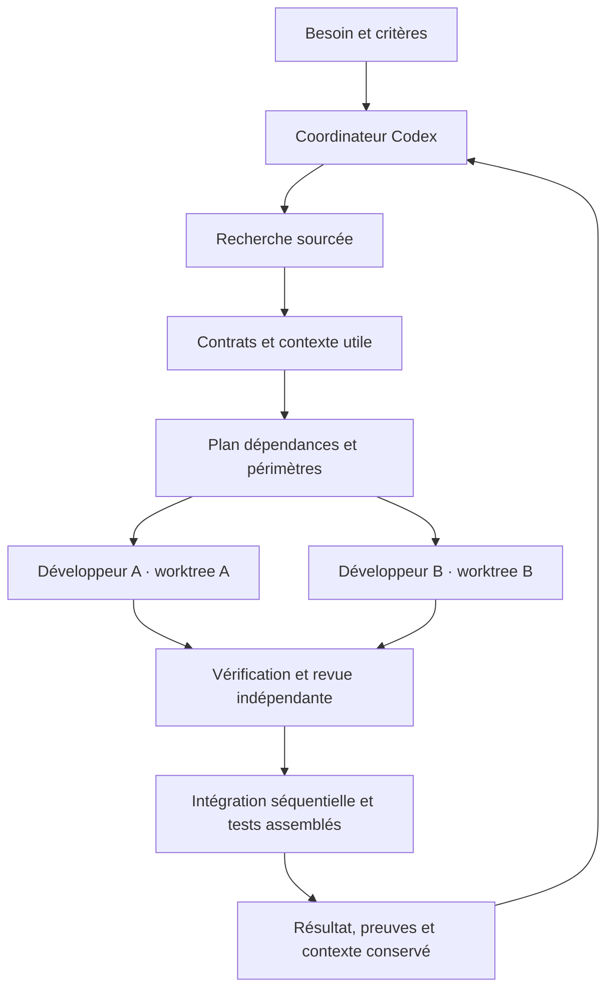

# project-template · mon socle Codex

Un point de départ personnel pour transformer une idée en projet vérifiable : cadrage, recherche, agents spécialisés, tâches isolées et intégration contrôlée.

Le cœur fonctionne localement avec **Python 3.11+ et Git**, sans bibliothèque externe ni clé API supplémentaire. Codex apporte les sous-agents et les outils disponibles dans ta session. Le script conserve l'état et calcule les tâches à distribuer ; il ne lance pas de modèles par lui-même.

## Démarrer

Ouvrir ce dossier comme projet dans Codex, vérifier ses instructions et lui accorder la confiance nécessaire au chargement de `.codex/config.toml`.

```text
Utilise $project-kickoff pour démarrer mon projet : [décrire le besoin].
Précise les critères de réussite, choisis la stack adaptée et mets en place ses tests.
```

Pour un projet déjà cadré :

```text
Utilise $project-orchestrate pour réaliser [objectif].
Fais rechercher les inconnues importantes, répartis les tâches indépendantes entre agents,
puis vérifie et intègre leurs résultats jusqu'aux critères de réussite.
```

Les skills sont dans `.agents/skills/`. Si le sélecteur ne les affiche pas, rouvrir le projet ou demander à Codex de lire le `SKILL.md` concerné. Aucun réglage global n'est nécessaire.

## Le cœur d'action



Le coordinateur est l'agent principal. Il distribue seulement les tâches prêtes et les données nécessaires à chacune. Les six spécialistes disponibles sont researcher, architect, implementer, verifier, reviewer et integrator. Trois spécialistes simultanés par défaut ; une tâche simple peut rester mono-agent.

Les capacités diffèrent réellement sur certains outils : l'architecte n'a ni shell ni connecteurs ; les agents de code n'ont pas les connecteurs applicatifs. **Les périmètres de fichiers et la lecture seule restent des consignes de travail**, pas des barrières système. Voir [les capacités et limites](docs/agents.md).

## Vérifier le socle

Depuis la racine, remplacer `python` par `python3` selon l'installation :

```bash
python scripts/validate_template.py
python scripts/project.py validate
python scripts/project.py check
python scripts/project.py status
```

La CI exécute ces contrôles sur Windows et Linux. Ils testent le moteur du template.
Lors du kickoff, configurer les vérifications du produit dans `project.json`, puis lancer :

```bash
python scripts/project.py check --application
```

Cette commande échoue tant que les tests du produit ne sont pas configurés. Un socle vert n'est pas une preuve que ton application fonctionne.

## Ce qui est livré

| Emplacement | Utilité |
| --- | --- |
| `AGENTS.md` | Accords de travail courts, lus par Codex |
| `PROJECT.md` | Besoin, périmètre et critères du projet actif |
| `project.json` | Paramètres du cœur et commandes de vérification |
| `.codex/agents/` | Six rôles spécialisés, sans modèle imposé |
| `.agents/skills/` | Kickoff, orchestration, recherche et clôture |
| `scripts/project.py` | Tableau de tâches, dépendances, plan, paquets et worktrees |
| `tasks/board.json` | État et historique versionnés ; un seul coordinateur écrivain |
| `templates/` | Modèles courts pour recherche, preuve et revue |
| `docs/` | Mode d'emploi, décisions, recherches et évolutions |
| `evaluations/` | Scénarios pour éprouver le comportement des agents |
| `.github/workflows/` | Vérification automatique du socle |
| `PERSONAL.example.md` | Préférences à copier dans `.local/PERSONAL.md` |

`.local/` est privé et ignoré par Git : préférences personnelles, paquets temporaires, worktrees et journaux. Mettre les décisions durables utiles au projet dans `docs/`, après retrait des informations sensibles.

## Réutiliser pour un nouveau projet

Créer un dépôt depuis ce template GitHub, ou copier ses fichiers dans un nouveau dossier en excluant `.git/` et `.local/`. Ouvrir la copie dans Codex puis lancer le kickoff. Le template initial conserve un tableau vide.

```bash
python scripts/project.py init --name mon-projet --goal "Le résultat concret attendu"
```

Choisir les composants nécessaires dans [docs/modules.md](docs/modules.md). Hébergement, base de données et LaTeX sont des options à ajouter selon le besoin.

Le [mode d'emploi](docs/operations.md) donne les commandes du cycle complet. La [feuille de route](docs/roadmap.md) distingue les fonctions présentes des extensions à réaliser. Les fichiers de configuration s'appuient sur la [documentation officielle vérifiée](docs/sources.md).
